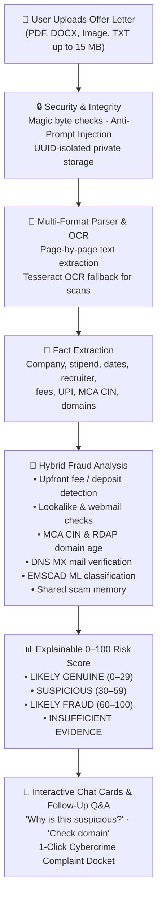
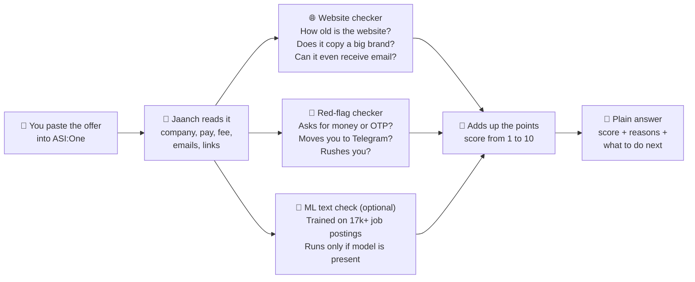
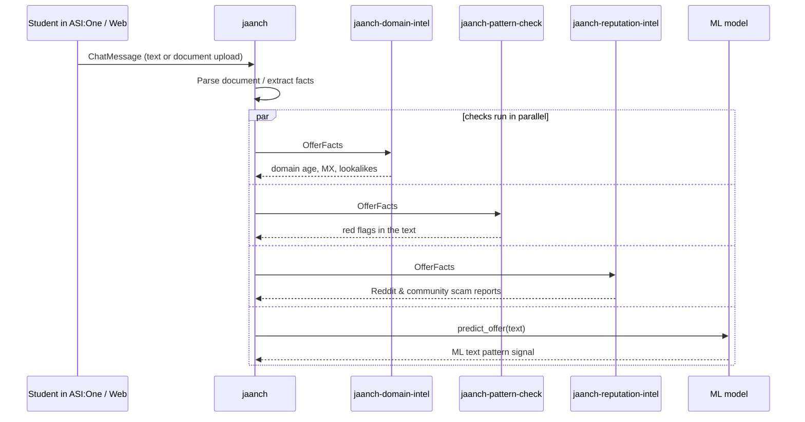

<p align="center">
<picture><source media="(prefers-color-scheme: dark)" srcset="assets/banner-dark.svg"><source media="(prefers-color-scheme: light)" srcset="assets/banner-light.svg"></picture>
</p>

**Got a job or internship offer that feels too good to be true?** Paste the message into Jaanch on ASI:One, or upload the offer letter (PDF, Word or image) in the Jaanch web app. In a few seconds you get an **explainable risk score**, the verified evidence behind it, and what to do next.

*Jaanch* (जाँच) means "check" in Hindi. It runs as a multi-agent system on Fetch.ai's Agentverse, reachable from **ASI:One** and from the built-in **Jaanch web app**.

> **Try it:** open [ASI:One](https://asi1.ai), type **`@jaanch-scam-check`**, and paste any job or internship message.

| Fetch-A-Thon requirement | How Jaanch meets it |
|---|---|
| Registered on Agentverse, usable in ASI:One | 4 agents on Agentverse; talk to `@jaanch-scam-check` in ASI:One |
| Agent Chat Protocol | `jaanch` speaks ACP; the whole check, report steps and complaint docket happen inside the chat |
| Multi-agent orchestration and tools | `jaanch` sends each offer to 3 specialist agents in parallel (website checks, red flags, Reddit) and calls live services: RDAP domain registries, Google DNS, Reddit, ASI1 |
| Interactive Cards | Every verdict is a card with evidence and buttons: *How do I report this?*, *Copy Cybercrime Docket*, *Signed report*, *Check another offer* |
| Payment Protocol | *Signed report* asks for 0.1 FET, checks the payment on the Fetch.ai ledger, then delivers a report signed by the agent ([details](#payment-protocol-signed-evidence-reports)) |
| Reliability | If a specialist doesn't answer in 20 s, `jaanch` runs that check itself; if ASI1 is down, rules take over; failed lookups are reported, never guessed |
| Keeps running after the hackathon | Shared scam memory grows with every check; students stay free, placement cells and job boards pay per report or per check |

---

## Why this matters

Fake job offers are everywhere, and they target students and first-time job seekers the most.

<p align="center">
<picture><source media="(prefers-color-scheme: dark)" srcset="assets/survey-dark.svg"><source media="(prefers-color-scheme: light)" srcset="assets/survey-light.svg"></picture>
</p>

<sub>Source: [Indeed survey reported by Business Today, July 2026](https://www.businesstoday.in/jobs/story/more-than-9-in-10-job-seekers-encounter-fake-job-offers-542006-2026-07-09)</sub>

In December 2023 the government blocked **more than 100 websites** running "work from home" job scams. They pulled people in with *"Ghar baithe job"* ads and then moved them to WhatsApp and Telegram ([MHA/I4C via The News Minute](https://www.thenewsminute.com/news/govt-blocks-100-websites-involved-in-job-scams-illegal-investments)).

Half the people in that survey said that knowing who the recruiter really is would make them trust an offer. **Checking that is exactly what Jaanch does for you.**

---

## 📄 Offer Letter Fraud Detection Agent

Upload an offer letter in the Jaanch web app (`python run.py web`) and it is analysed as legitimate, suspicious or fraudulent. In ASI:One, paste the letter's text.



### Core Document Analysis Capabilities

1. **Multi-Format Ingestion (up to 15 MB):**
   - **PDF:** Page-by-page text extraction with encrypted file detection.
   - **DOCX:** Paragraph and tabular offer term extraction.
   - **Images (PNG, JPG, JPEG, WEBP):** Pillow metadata parsing with OCR fallback for screenshots.
   - **Plain Text (TXT):** Safe multi-encoding read with text normalization.

2. **Zero-Trust Security & Integrity:**
   - Strict MIME and magic byte signature verification (`%PDF-`, `PK\x03\x04`, `\xFF\xD8\xFF`, etc.).
   - Path-traversal sanitization and unique UUID file isolation in `data/uploads/`.
   - Anti-prompt injection encapsulation (`wrap_untrusted_text`) preventing embedded prompt overrides.

3. **Hybrid Verification Engine:**
   - **Fee & Payment Traps:** Detects refundable fees, kit costs, training deposits, and personal UPI handles (`@okaxis`, `@paytm`, `@ybl`).
   - **Company & Recruiter Verification:** Validates 21-character MCA CIN corporate registration format, cross-checks official company domains, and detects freemail spoofing (e.g. `wipro.careers@gmail.com`).
   - **Domain & Email Infrastructure:** Authoritative IANA/RDAP domain creation age lookups and DNS MX mail routing checks.
   - **EMSCAD Machine Learning:** Classifies textual similarity against 17,880 historical job listings.
   - **Cross-User Shared Memory:** HMAC-fingerprinted scammer indicators (phone, email, UPI, links) flagged across all student inquiries.

4. **Conversational Follow-Up Q&A:**
   Students can ask follow-up questions directly in the chat without re-scanning:
   - *"Why is this offer suspicious?"*
   - *"Which exact details indicate fraud?"*
   - *"Check the company domain."*
   - *"Is the stipend realistic?"*
   - *"What should I verify before joining?"*
   - *"Summarize the findings."*

5. **1-Click Cybercrime Complaint Docket:**
   Generates a structured, evidence-backed cybercrime docket ready for filing at **1930** or **cybercrime.gov.in**.

---

## How it works (Pasted Text Workflow)



---

## How to read the score

Every text offer starts at **2** (or 0–100 scale for documents). Warning signs add points and genuine credentials reduce risk:

| What Jaanch finds | Text Score | Document Impact |
|---|:---:|:---:|
| 💸 Asks you to **pay a fee or deposit** to get the job | **+4** | **+35 pts** (Critical) |
| 💸 Directs payment to a **personal UPI handle** (`@okaxis`, `@paytm`) | **+3** | **+25 pts** (High) |
| 🏛️ Fabricated or invalid **MCA / CIN corporate registration number** | **+3** | **+20 pts** (High) |
| 🎓 **Course / Mentorship upsell bait** (paid training before job) | **+3** | **+20 pts** (High) |
| 🧠 Repeat scammer identified in **cross-student shared memory** | **+3** | **+20 pts** (High) |
| 🎭 Website **copies a big company's name** (lookalike domain) | **+3** | **+30 pts** (Critical) |
| 🆕 Website was **registered less than 30 days ago** | **+3** | **+25 pts** (High) |
| 🔐 Asks for your **OTP, UPI PIN, card details** or remote access | **+3** | **+25 pts** (High) |
| 📧 Recruiter uses **free webmail (Gmail, Yahoo)** for big company | **+2.5** | **+20 pts** (High) |
| 📄 Asks for **blank cheque, original marksheets, or bond** | **+2.5** | **+20 pts** (High) |
| ✈️ Moves you to **Telegram or a private WhatsApp group** | **+2** | **+15 pts** (Medium) |
| ❓ The website **doesn't exist** or has no mail exchangers (MX) | **+2** | **+15 to 25 pts** |
| 🤖 **Text matches fraudulent posting dataset** (ML classifier) | **+1.5 to +2** | **+15 pts** |
| ⏳ **Artificial scarcity / rush** ("Only 3 slots left", "24 hrs only") | **+1** | **+10 pts** |
| 🏢 **Valid MCA CIN registration number** | −1 | −15 pts |
| 🏫 Verified **educational or campus placement domain** (`.ac.in`) | **−2** | −20 pts |
| ✅ Recruiter email matches **company's official domain** | **−2** | −20 pts |
| 📝 **Structured multi-round interview process** mentioned | **−1** | −10 pts |
| ✅ Website is **more than 5 years old** | **−1** | −10 pts |

### Classification Tiers (0–100 Scale)
* **0–29: LIKELY GENUINE** — Legitimate employer credentials, active email servers, standard interview process.
* **30–59: SUSPICIOUS** — Unverified domain, missing employer verification, or non-standard communication.
* **60–100: LIKELY FRAUD** — Direct monetary demands, personal UPI, lookalike brand domains, or forged credentials.
* **INSUFFICIENT EVIDENCE** — Emitted when an offer contains insufficient verifiable text or contact information.

---

## Web Chat Interface & REST API

Jaanch includes a built-in Web Chat interface and REST API powered by FastAPI.

### Launch the Web App
```bash
python run.py web
```
Open **`http://localhost:8010`** in your browser. It listens on this computer only; set `JAANCH_WEB_HOST=0.0.0.0` to share it on your network.

### Features:
- 📎 **File Attachment (+ / Paperclip):** Upload PDF, DOCX, PNG, JPG, WEBP, TXT documents up to 15 MB.
- 🖼️ **Image Previews & Metadata:** Live preview of uploaded screenshots and document size.
- ⚡ **Interactive Risk Meter:** Visual 0–100 risk gauge and color-coded status pills.
- 🔍 **Expandable Evidence Drawers:** Deep dive into positive signals, risk indicators, and limitations.
- 💬 **Quick Follow-Up Buttons:** Instant one-click follow-up queries (*"Why is this suspicious?"*, *"Check domain"*, *"Is stipend realistic?"*).
- 📋 **Copy Complaint Docket:** Instant clipboard copy of the pre-formatted cybercrime complaint docket.

### REST API Endpoints
- `POST /api/documents/upload`: Multipart file upload with conversation tracking and full JSON analysis.
- `GET  /api/documents/{doc_id}`: Retrieve a stored document's analysis by ID.
- `GET  /api/documents/history`: List recent document analyses.
- `POST /api/chat`: Conversational chat endpoint handling pasted offers, follow-up Q&A, and dockets.
- `GET  /api/health`: Health probe and service metadata.
- `GET  /`: Web Chat interface.

---

## Shared scam memory: what ChatGPT can't do

Every ChatGPT conversation is on its own. Jaanch is one agent that every student talks to, so it learns from all of them.

When an offer comes out **high risk**, Jaanch remembers the scammer's contacts: phone numbers, emails, websites, UPI IDs, Telegram accounts and short links. If another student later pastes a *different* message that reuses any of them, Jaanch warns them: *"This email address was already flagged in earlier scam checks"*.

- **Private by design.** Only a keyed fingerprint (HMAC-SHA256) of each contact is stored, never the contact and never the raw message.
- **Can't be used to frame a real company.** Official company and college domains, Gmail/Yahoo as domains, and WhatsApp/Telegram themselves are never stored.
- **No double counting.** Checking the same message repeatedly does not inflate the count.

---

## Payment Protocol: signed evidence reports

**Students never pay.** The check, the report steps and the complaint docket are free, always.

The paid product is a **signed evidence report** (0.1 FET by default, set with `JAANCH_REPORT_PRICE_FET`). Jaanch signs it with its agent key, so anyone can prove it is genuine and unedited:

- **Placement cells** buy one before forwarding an internship to hundreds of students, and attach it to the circular.
- **Students who were scammed** attach one to a police or cybercrime complaint as timestamped evidence: website age, mail server, red flags, all as checked at that moment.
- **Job boards and career agents** that call Jaanch through `JaanchOfferVerification` are the next customers for per-check pricing.

How it runs inside ASI:One:

1. Click **Signed report** on any verdict card. Jaanch sends a `RequestPayment` (FET, `fet_direct`, 5-minute deadline).
2. Approve it in ASI:One. ASI:One sends `CommitPayment` with the transaction hash.
3. Jaanch looks the transaction up on the Fetch.ai ledger and checks that the right amount reached its wallet. Each transaction is accepted once.
4. Jaanch sends `CompletePayment` and the signed report. If the check fails, it sends `CancelPayment` with the reason, and nothing is delivered.

It runs on the **Dorado testnet** by default (free test FET from the faucet), so nobody spends real money by accident; set `JAANCH_FET_TESTNET=false` for mainnet. The report contains a fingerprint of the message, never the message itself. To check a report, copy it into a file and run `python scripts/verify_report.py report.txt`.

---

## Think it's a scam? Do this

1. **Don't pay anything** and stop replying. Never share an OTP, PIN or ID documents.
2. **Already paid or shared bank details?** Call the cyber-fraud helpline **1930** right away. The faster you report, the better the chance of freezing the money.
3. File a complaint at **[cybercrime.gov.in](https://cybercrime.gov.in)**.
4. Report the number on **[Sanchar Saathi → Chakshu](https://sancharsaathi.gov.in)**, and block the chat in WhatsApp or Telegram.
5. Tell your college placement cell so they can warn other students.

In ASI:One or Web Chat, click **"How do I report this?"** or **"Copy Cybercrime Docket"** to get pre-formatted details.

---

## For developers

<details>
<summary><b>Agents and protocols</b></summary>

<br>

| Agent | What it does | Protocols | Address |
|---|---|---|---|
| `jaanch` (`@jaanch-scam-check`) | Talks to users in ASI:One, runs the check, sells signed reports | AgentChatProtocol 0.3.0, JaanchOfferVerification 1.0.0, AgentPaymentProtocol 0.1.0 | `agent1qvvzp4xwu6c9ct6xrj8swxeet8aep6g36jf5cafegdfzh633zq3n7m4sd5u` |
| `jaanch-domain-intel` | Domain age (RDAP), mail server (MX), lookalike brands | JaanchDomainIntel 0.1.0 | `agent1qgu0xxylvpa9kv7he3vux9kj5x2l9ffdlad0hsh84nv23vf7avyw68j33th` |
| `jaanch-pattern-check` | Red flags in the text | JaanchPatternCheck 0.1.0 | `agent1qtwpt528nq7x73s3jxwtpfq9056wltxkwwn8d5393cdd2e4rpyxkjm34s46` |
| `jaanch-reputation-intel` | Reddit & community discussion sentiment and scam reports | JaanchReputationIntel 0.1.0 | printed by `python run.py reputation` |



### Agent-to-Agent Autonomous B2B Protocol (`JaanchOfferVerification`)
Other agents in the Fetch.ai ecosystem (such as college placement cell agents, career assistants, or job boards) can query Jaanch autonomously before displaying listings to students:

- **Request:** `VerifyOfferRequest { offer_text: str, source_url: str | null }`
- **Response:** `VerifyOfferResponse { risk_score: int, verdict: "low_risk" | "suspicious" | "high_risk", reasons: [str], checked_domains: [str] }`

```bash
# Run the autonomous B2B placement screening demonstration
JAANCH_MAILBOX=0 python scripts/placement_oracle_demo.py
```
*A mock university placement cell agent screens incoming recruiter listings over uAgents protocols, automatically quarantining high-risk scam listings (>=7) and approving legitimate ones.*

</details>

<details>
<summary><b>ML Classifier: Dataset, Training & Evaluation</b></summary>

<br>

Jaanch integrates a machine learning classifier trained on the **Employment Scam Aegean Dataset (EMSCAD)** (17,880 verified job postings):

### 1. Dataset Download & Placement
1. Download `fake_job_postings.csv` from [Kaggle EMSCAD Dataset](https://www.kaggle.com/datasets/shivamb/real-or-fake-fake-jobposting-prediction).
2. Place the file at `data/raw/fake_job_postings.csv`.

### 2. Data Preparation & Deduplication
```bash
python scripts/prepare_dataset.py
```
This writes processed CSVs to `data/processed/`, label mapping to `data/labels/target_mapping.json`, and an inspection report to `data/reports/dataset_report.json`.

### 3. Model Training
```bash
python scripts/train_model.py
```
Saves the fitted pipeline to `models/job_scam_model.joblib` and metadata to `models/job_scam_model_metadata.json`.

### 4. Held-Out Evaluation
```bash
python scripts/evaluate_model.py
```
**Measured Test Metrics (Held-out Test Set, n=2,633):**
* PR-AUC: 0.8653 | ROC-AUC: 0.9827
* Majority Class Baseline F1: 0.0000
* Logistic Regression @ validation-selected threshold (0.65):
  * Scam Precision: 81.67%
  * Scam Recall: 75.97%
  * Scam F1-Score: 78.71%
  * Legitimate Precision: 98.77% | Legitimate Recall: 99.12%

### 5. Enabling / Disabling ML Inference
* Enable: `JAANCH_ENABLE_ML=1`
* Disable: `JAANCH_ENABLE_ML=0`
* Custom model path: `JAANCH_ML_MODEL_PATH=path/to/custom_model.joblib`

</details>

<details>
<summary><b>Run it yourself</b></summary>

<br>

Needs Python 3.10–3.13.

```bash
# 1. Install dependencies
pip install -r requirements.txt

# 2. Configure environment
cp .env.example .env        # add ASI1_API_KEY and seed phrases

# 3. Quick terminal check or OCR flyer scan
python scripts/check.py samples/scam_fee_whatsapp.txt     # one check, no agents
python scripts/scan_image.py path/to/screenshot.png      # OCR scan of a flyer/screenshot (needs Tesseract installed)

# 4. Autonomous B2B Multi-Agent Placement Screening
JAANCH_MAILBOX=0 python scripts/placement_oracle_demo.py  # autonomous agent-to-agent screening

# 5. Run Web Chat & REST API
python run.py web           # http://localhost:8010 (this computer only)

# 6. Run Agents on Agentverse
python run.py               # All agents connected to Agentverse
python run.py jaanch        # one agent per terminal: jaanch | domain | pattern | reputation (ports 8000-8003)

# 7. Run Tests
pytest -v                   # offline test suite
```

</details>

<details>
<summary><b>Project layout</b></summary>

<br>

```
agents/        the uAgents (orchestrator + specialists) and Agentverse READMEs
data/          dataset directory (raw, processed, labels, reports, uploads)
jaanch/        core detection logic:
               ├── api.py               FastAPI REST backend and web router
               ├── web/                 Integrated Web Chat interface
               ├── document_parser.py   PDF, DOCX, Image, and TXT parser + OCR
               ├── document_security.py Magic-byte validation, upload limits, anti-injection
               ├── document_analyzer.py Hybrid 0-100 fraud scoring engine
               ├── document_store.py    SQLite document and conversation persistence
               ├── document_qa.py       Conversational follow-up Q&A engine
               ├── extract.py           Fact and entity extraction
               ├── domain_intel.py      RDAP domain age, MX records, lookalikes
               ├── patterns.py          Red-flag and scam phrase detection
               ├── pipeline.py          Text scoring orchestration & ML inference
               ├── scoring.py           Rule-based scoring formulas
               └── cards.py             ASI:One ACP and web interactive cards
models/        trained ML model pipeline artifact and metadata JSON
samples/       test messages and offer letters (synthetic and real examples)
scripts/       data prep, model training, evaluation, one-off check, and local demo
tests/         117 unit and integration tests with offline fixtures
run.py         entry point: starts agents or web app (python run.py web)
```

</details>

---

## What's built and what's next

**Built:**
- 📄 **Offer Letter Fraud Detection Agent:** Complete document upload (PDF, DOCX, JPG/PNG/WEBP, TXT up to 15 MB), magic byte validation, page tracking, OCR fallback, MCA CIN validation, 0–100 explainable risk scoring, interactive cards, and follow-up Q&A.
- 🎓 **Autonomous Campus Placement Oracle:** B2B agent-to-agent protocol (`JaanchOfferVerification`) allowing college placement agents and job boards to screen recruiter listings automatically.
- 💬 **Reddit & Community Reputation Agent:** Specialist agent (`jaanch-reputation-intel`) that searches Reddit for scam and fee complaints about the company or website in the offer.
- 📸 **WhatsApp Screenshot & Flyer OCR Tool:** Command-line scanner (`scripts/scan_image.py`) that reads text from flyers and WhatsApp screenshots with Tesseract OCR and checks it.
- 🌐 **Web Chat & REST API:** FastAPI-powered chat interface with file drag-and-drop, risk meter, and endpoints.
- 🤖 **ML Scam Classifier (optional):** Trained on EMSCAD (17,880 postings), 0.865 PR-AUC and 78.7% F1 on held-out data. The model file is not in this repo; build it with the steps above. EMSCAD is English job-board data, so it adds one signal and never decides the verdict.
- 🧠 **Cross-Student Shared Scam Memory:** Keyed HMAC-SHA256 fingerprinting that catches repeat scam contacts across independent checks without storing private messages.
- 🌐 **Live Infrastructure Intel:** RDAP domain age, DNS MX mail servers, and lookalike detection.
- 🇮🇳 **Hinglish & Local Traps:** Hinglish phrasing, Telegram task fraud, and fake MCA registrations.
- 📋 **Cybercrime Docket Generator:** 1-Click pre-formatted complaint docket ready for 1930 / cybercrime.gov.in / Chakshu.
- 💳 **Payment Protocol:** signed evidence reports paid in FET, verified on the Fetch.ai ledger before delivery, with replay protection.

**Next:**
- 📲 Read offers sent as files and screenshots directly in ASI:One (today: paste the text in ASI:One, or upload in the web app).
- 💼 Per-check pricing for job boards calling `JaanchOfferVerification`.
- 🏢 Direct API integration with the Ministry of Corporate Affairs (MCA) live company master data API.

---

<p align="center">
Built for <b>Fetch-A-Thon 3.0</b> (Masters' Union, 24 Oct 2026) by <b>Team Chiranjivi</b><br>
Abhishek Goswami · Anirudh Kumar · Parv Mishra · Anmol Gola · GLA University, Mathura
</p>
