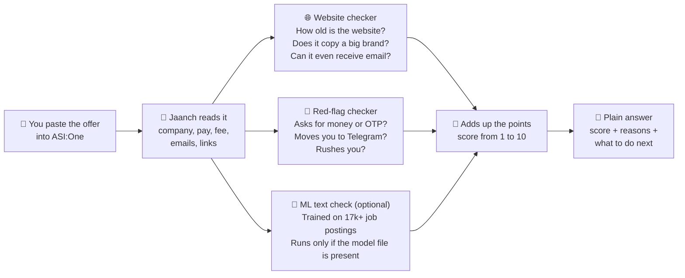
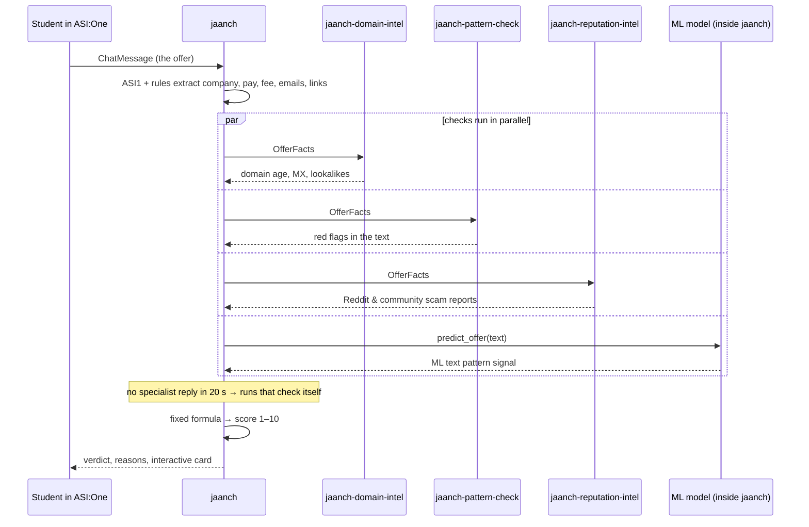

<p align="center">
<picture><source media="(prefers-color-scheme: dark)" srcset="assets/banner-dark.svg"><source media="(prefers-color-scheme: light)" srcset="assets/banner-light.svg"></picture>
</p>

**Got a job or internship offer that feels too good to be true?** Paste it into Jaanch. In a few seconds you get a **risk score from 1 to 10**, the reasons behind it, and what to do next.

*Jaanch* (जाँच) means "check" in Hindi. It runs as three small AI agents on Fetch.ai's Agentverse, and you talk to it in **ASI:One**, like any chat app.

---

## Why this matters

Fake job offers are everywhere, and they target students and first-time job seekers the most.

<p align="center">
<picture><source media="(prefers-color-scheme: dark)" srcset="assets/survey-dark.svg"><source media="(prefers-color-scheme: light)" srcset="assets/survey-light.svg"></picture>
</p>

<sub>Source: [Indeed survey reported by Business Today, July 2026](https://www.businesstoday.in/jobs/story/more-than-9-in-10-job-seekers-encounter-fake-job-offers-542006-2026-07-09)</sub>

In December 2023 the government blocked **more than 100 websites** running "work from home" job scams. They pulled people in with *"Ghar baithe job"* ads and then moved them to WhatsApp and Telegram ([MHA/I4C via The News Minute](https://www.thenewsminute.com/news/govt-blocks-100-websites-involved-in-job-scams-illegal-investments)).

Half the people in that survey said that knowing who the recruiter really is would make them trust an offer. **Checking that is exactly what Jaanch does for you.**

---

## How it works



Two helper agents do the checking at the same time, and an optional ML text classifier inside the main agent adds one more signal when its model file is present. Job-search and career agents can also ask Jaanch to check a listing *before* they show it to you.

---

## How to read the score

<p align="center">
<picture><source media="(prefers-color-scheme: dark)" srcset="assets/scale-dark.svg"><source media="(prefers-color-scheme: light)" srcset="assets/scale-light.svg"></picture>
</p>

Every offer starts at **2**. Each warning sign adds points and each good sign takes some away:

| What Jaanch finds | Points |
|---|:---:|
| 💸 Asks you to **pay a fee or deposit** to get the job | **+4** |
| 💸 Directs payment to a **personal UPI handle** (`@okaxis`, `@paytm`, `@ybl`) | **+3** |
| 🏛️ Fabricated or invalid **MCA / CIN corporate registration number** | **+3** |
| 🎓 **Course / Mentorship upsell bait** (requires paid training before internship) | **+3** |
| 🎭 Website **copies a big company's name** (like `infosys-careers.in` or `wipr0.com`) | **+3** |
| 🆕 Website was **made less than 30 days ago** | **+3** |
| 🔐 Asks for your **OTP, UPI PIN, card details** or remote access to your phone | **+3** |
| 👍 Pays you for **"tasks"** like liking videos or writing reviews | **+3** |
| 📧 Says it's a big company but emails from **Gmail, Yahoo or Outlook** | **+2.5** |
| 📄 Asks for **blank/cancelled cheque, original marksheets, or bond** | **+2.5** |
| 🌐 **Reddit & Community discussions** flag company/domain for scam or fraud | **+2.5** |
| ✈️ Moves you to **Telegram or a WhatsApp group / chat** (`chat.whatsapp.com`) | **+2** |
| 🤑 Promises **a lot of money for very little work** | **+2** |
| ❓ The website **doesn't exist** at all | **+2** |
| 🤖 **Text matches fraudulent posting dataset** (ML classifier) | **+1.5 to +2** |
| 📋 Uses **Google Forms / Linktree** for big company hiring | **+1.5** |
| 📱 **Only personal mobile number** provided without official email | **+1.5** |
| 🕐 Website less than 6 months old · its email can't receive mail · **direct selection without interview / application** | **+1.5** each |
| ⏳ **Artificial scarcity / countdown** ("Only 3 slots left", "Batch filling fast") | **+1** |
| 🛡️ Touts **MCA / CIN registration** to manufacture trust | **+1** |
| 🎣 Vague or **performance-conditional stipend ("Up To ₹...")** | **+1** |
| 🪪 Wants **Aadhaar, PAN or bank details** before any interview · **rushes you or pushes same-day induction** · uses **short links** · recruiter on a free email | **+1** each |
| 👋 Starts with a generic **"Dear candidate"** | **+0.5** |
| 🌐 Uses verified **enterprise ATS portal** (Greenhouse, Lever, Workday) | **−2** |
| 🏫 Verified **educational or campus placement domain** (`.ac.in` / `.edu`) | **−2** |
| ✅ Email comes from the **company's real website** | **−2** |
| 📝 **Structured multi-round interview process** mentioned | **−1** |
| ✅ Website is **more than 5 years old** | **−1** |

The score always stays between 1 and 10.

---

## Does it work?

We wrote six test messages that copy real Indian job scams (and two genuine offers) and ran them through Jaanch:

<p align="center">
<picture><source media="(prefers-color-scheme: dark)" srcset="assets/results-dark.svg"><source media="(prefers-color-scheme: light)" srcset="assets/results-light.svg"></picture>
</p>

All three scams scored **10**, both genuine offers scored **1**, and the borderline one landed in the middle. The messages are in [`samples/`](samples/).

### Where does a score come from?

Here's the fake Infosys email, point by point:

<p align="center">
<picture><source media="(prefers-color-scheme: dark)" srcset="assets/breakdown-dark.svg"><source media="(prefers-color-scheme: light)" srcset="assets/breakdown-light.svg"></picture>
</p>

Every point comes from something you can see in the message or check about the website.

---

## Why you can trust the score

- **The AI never decides the score.** The LLM only reads the messy message and explains the result in simple words. The score itself is a fixed mathematical formula over verifiable signals (domain intelligence, rule checks, and ML text classification).
- **The ML model provides evidence, not a black-box verdict.** The classifier acts as an additional evidence source (+1.5 to +2.0 risk weight). It never overrides strong rule or domain evidence.
- **It understands "no".** *"There is **no** registration fee"* is not counted as asking for a fee.
- **It keeps working when something breaks.** If a helper agent doesn't answer in 20 seconds, the main agent does that check itself. If the ML model artifact is missing or disabled, Jaanch continues with rule and domain evidence. If a website lookup fails, Jaanch notes it instead of guessing.
- **It speaks Hinglish.** Many scams are written in Hinglish, and Jaanch catches those red flags too.

---

## Think it's a scam? Do this

1. **Don't pay anything** and stop replying. Never share an OTP, PIN or ID documents.
2. **Already paid or shared bank details?** Call the cyber-fraud helpline **1930** right away. The faster you report, the better the chance of freezing the money.
3. File a complaint at **[cybercrime.gov.in](https://cybercrime.gov.in)**. Keep screenshots, the sender's number or email, and any payment IDs.
4. Report the number on **[Sanchar Saathi → Chakshu](https://sancharsaathi.gov.in)**, and block the chat in WhatsApp or Telegram.
5. Tell your college placement cell so they can warn other students.

In ASI:One, tap **"How do I report this?"** on Jaanch's answer to get these steps.

---

## For developers

<details>
<summary><b>Agents and protocols</b></summary>

<br>

| Agent | What it does | Protocols | Address |
|---|---|---|---|
| `jaanch` | Talks to users in ASI:One and runs the check | AgentChatProtocol 0.3.0, JaanchOfferVerification 1.0.0 | *fill in after first run* |
| `jaanch-domain-intel` | Domain age (RDAP), mail server (MX), lookalike brands | JaanchDomainIntel 0.1.0 | *fill in after first run* |
| `jaanch-pattern-check` | Red flags in the text | JaanchPatternCheck 0.1.0 | *fill in after first run* |
| `jaanch-reputation-intel` | Reddit & community discussion sentiment and scam reports | JaanchReputationIntel 0.1.0 | *fill in after first run* |



Other agents can call the same check:

- Request: `VerifyOfferRequest { offer_text: str, source_url: str | null }`
- Response: `VerifyOfferResponse { risk_score: int, verdict: "low_risk" | "suspicious" | "high_risk", reasons: [str], checked_domains: [str] }`

</details>

<details>
<summary><b>ML Classifier: Dataset, Training & Evaluation</b></summary>

<br>

Jaanch integrates a machine learning classifier trained on the **Employment Scam Aegean Dataset (EMSCAD)** (17,880 verified job postings):

### 1. Dataset Download & Placement
1. Download `fake_job_postings.csv` from [Kaggle EMSCAD Dataset](https://www.kaggle.com/datasets/shivamb/real-or-fake-fake-jobposting-prediction).
2. Place the file at:
   ```
   data/raw/fake_job_postings.csv
   ```

### 2. Data Preparation & Deduplication
Run data inspection, deduplication, composite text construction, and stratified splitting (70% train, 15% val, 15% test):
```bash
python scripts/prepare_dataset.py
```
This writes processed CSVs to `data/processed/`, label mapping to `data/labels/target_mapping.json`, and an inspection report to `data/reports/dataset_report.json`.

### 3. Model Training
Train the scikit-learn TF-IDF + class-weighted Logistic Regression pipeline and compare with a Linear SVM baseline:
```bash
python scripts/train_model.py
```
Saves the fitted pipeline to `models/job_scam_model.joblib` and full metadata to `models/job_scam_model_metadata.json`.

### 4. Held-Out Evaluation
Evaluate the model on the held-out test set (isolated from training and threshold selection):
```bash
python scripts/evaluate_model.py
```
Outputs confusion matrix, scam precision/recall/F1, PR-AUC, and baseline comparisons to `data/reports/evaluation_report.json`.

**Measured Test Metrics (Held-out Test Set, n=2,633):**
* PR-AUC: 0.8653 | ROC-AUC: 0.9827
* Majority Class Baseline F1: 0.0000
* Logistic Regression @ validation-selected threshold (0.65):
  * Scam Precision: 81.67%
  * Scam Recall: 75.97%
  * Scam F1-Score: 78.71%
  * Legitimate Precision: 98.77% | Legitimate Recall: 99.12%

### 5. Enabling / Disabling ML Inference
The trained model file (`models/job_scam_model.joblib`) is **not in this repo** because of its size. Build it with steps 1–3 above; without it, Jaanch skips this check and scores on the domain and red-flag evidence alone. ML inference is enabled by default if the model artifact exists. You can toggle it via environment variable:
* Enable: `JAANCH_ENABLE_ML=1`
* Disable: `JAANCH_ENABLE_ML=0`
* Custom model path: `JAANCH_ML_MODEL_PATH=path/to/custom_model.joblib`

### 6. Known Limitations
* **Historical job board data:** EMSCAD is derived from global/English online job postings, while modern Indian student scams predominantly occur over WhatsApp/Telegram with Hinglish text and UPI demands.
* **Complementary evidence:** The model evaluates textual resemblance to scam postings; it does not replace live domain lookups or payment demand detection.

### 7. Privacy & Git Hygiene
Raw datasets, processed splits, and binary `.joblib` models are gitignored. Never commit `.env`, credentials, phone numbers, or private candidate messages.

</details>

<details>
<summary><b>Run it yourself</b></summary>

<br>

Needs Python 3.10–3.13.

```bash
pip install -r requirements.txt
cp .env.example .env        # add ASI1_API_KEY and three seed phrases

python scripts/check.py samples/scam_fee_whatsapp.txt     # one check, no agents
JAANCH_MAILBOX=0 python scripts/local_demo.py             # all agents + test clients, locally
python run.py                                             # all agents, connected to Agentverse
python run.py jaanch    # or: domain / pattern; one agent per terminal
pytest -q                                                 # 68 tests, no network needed (4 skip until you build the ML model)
```

On Windows, set variables with `set JAANCH_MAILBOX=0` before the command.

</details>

<details>
<summary><b>Put it on Agentverse and ASI:One</b></summary>

<br>

1. Get an ASI1 API key at asi1.ai/dashboard/api-keys and put it in `.env` with three long random seed phrases.
2. `python run.py`. It prints the three agent addresses; copy them into the agents table above. (If ASI:One can't reach the agents when they share one process, run `python run.py jaanch`, `python run.py domain` and `python run.py pattern` in three terminals instead.)
3. Open the Agent Inspector link printed for `jaanch`, click **Connect → Mailbox**. Repeat for the two specialists.
4. In Agentverse, open the `jaanch` profile and check that the README and badges show. Click **Chat with Agent** to open ASI:One, then paste a sample from `samples/`.
5. Share the ASI:One chat to get the public chat URL for the submission.

</details>

<details>
<summary><b>Project layout</b></summary>

<br>

```
agents/        the three uAgents (orchestrator + two specialists) and their Agentverse READMEs
data/          dataset directory (raw, processed, labels, reports)
jaanch/        the checking logic: extraction, domain intel, patterns, ML detector, scoring, ASI1 calls
models/        trained ML model pipeline artifact and metadata JSON
samples/       test messages (synthetic and real examples)
scripts/       data prep, model training, evaluation, one-off check, and local demo
tests/         66 unit and integration tests with offline fixtures
run.py         starts the agents
```

</details>

---

## What's built and what's next

**Built:** three agents with the Chat Protocol and a public verification protocol, an ML recruitment scam classifier trained on EMSCAD, ASI1 extraction and explanation with fallbacks, intent routing for general Q&A and scam advice, live website checks, Hinglish red flags, detection for mass WhatsApp induction traps, an ASI:One card with "How do I report this?", a local demo, and offline tests.

**Next:**
- 📸 Read **screenshots** of offers, since most scams arrive as images on WhatsApp.
- 🤝 A shared list where reports from verified students raise the risk of repeat scam numbers and websites.
- 💳 A paid deep report using the Payment Protocol.
- 🏢 A bigger list of real employers to compare against.

---

<p align="center">
Built for <b>Fetch-A-Thon 3.0</b> (Masters' Union, 24 Oct 2026) by <b>Team Chiranjivi</b><br>
Abhishek Goswami · Anirudh Kumar · Parv Mishra · Anmol Gola · GLA University, Mathura
</p>
